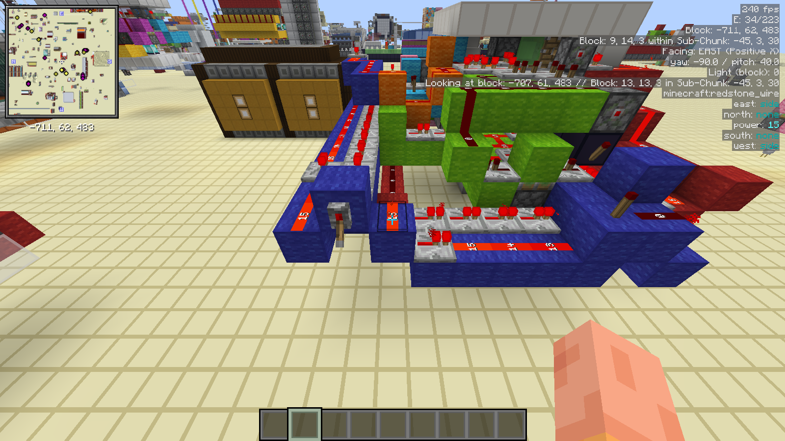

# RedstoneExMachina

**A Minecraft 26.2 Fabric modpack for technical redstone players.**

Fast rendering, every technical tool set up, hotkeys without collisions and an in-game hotkey menu.

[Download the latest .mrpack](https://github.com/federicotorrielli/RedstoneExMachina/releases/latest) · [Mod list](MODS.md) · [Hotkeys](https://federicotorrielli.me/RedstoneExMachina/hotkeys.html) · [Changelog](CHANGELOG.md)

## What you get

- **Circuit analysis.** Redstone Multimeter for event timelines, G4mespeed for tick rate control, Chunk Debug for loaded and ticking chunks, Pistorder for piston movement order, Carpet and Carpet TIS Addition for profiling and microtiming logs.
- **Building.** Litematica with easy place, Tweakeroo with flexible and accurate placement, Technical Utilities, Item Scroller, Chest Tracker.
- **Information on screen.** MiniHUD shows FPS, entities, block position, position inside the sub-chunk, facing, yaw and pitch, light, the targeted block, its block states and comparator output. TweakerMore's info view shows comparator levels, hopper cooldowns and redstone dust update order on the block you look at.
- **Performance.** Sodium, Lithium, ImmediatelyFast, FerriteCore, ModernFix, Voxy for distant terrain and the Fabulously Optimized base. The renderer versions (Sodium 0.9.1, Iris 1.11.2) are pinned because newer ones break terrain with Photon.
- **Looks.** Photon shaders (off by default, press `K`), Redstone Tweaks in its Computational preset, re-OCD, and a red RedstoneExMachina interface.
- **Hotkeys that do not fight.** Ten collisions between mods were fixed. Each MaLiLib mod has its own leader key, and a menu in the pause screen lists every key.

## Install

The pack uses the Modrinth format (`.mrpack`). The launcher downloads every mod from Modrinth and checks its hash.

1. Download `RedstoneExMachina-<version>.mrpack` from the [latest release](https://github.com/federicotorrielli/RedstoneExMachina/releases/latest).
2. Import it:
   - **Prism Launcher:** *Add Instance* → *Import* → choose the file.
   - **Modrinth App:** *Library* → *+* → *From file*.
   - Other launchers that read `.mrpack` files work the same way.
3. Give the instance about 6 to 8 GB of memory and use Java 25.

On first launch you see the RedstoneExMachina welcome screen. Your settings are created from `config/modpack_defaults` once; later updates never overwrite them.

## Hotkeys

Open the pause menu and click **⚡ Press here for hotkeys**. The menu has seven pages (circuit timing, block info, placing blocks, schematics, HUD and view, inventories, other), with an item icon for every key.

  
  

"H+C" means: hold H, then press C. The first key names the mod:

| Leader | Mod | Settings |
| --- | --- | --- |
| `H` | MiniHUD | `H+C` |
| `M` | Litematica | `M+C` |
| `X` | Tweakeroo | `X+C` |
| `N` | TweakerMore | `N+C` |
| `I` | Item Scroller | `I+C` |
| `J` | Technical Utilities | `J+C` |
| `A` | every MaLiLib mod in one list | `A+C` |

A few keys used most often: `F6` adds a multimeter meter, `F7` shows the timeline, `G` changes the tick rate, `N+I` turns on the block info view, `M+E` toggles easy place, `X+F` and `X+A` toggle flexible and accurate placement. The full list is in [docs/hotkeys.html](https://federicotorrielli.me/RedstoneExMachina/hotkeys.html).

## Multiplayer

Most tools work on any server. Accurate data needs server support: MiniHUD and Litematica read server data through Servux, and Redstone Multimeter, Chunk Debug and Carpet need their server mods. For your own Fabric 26.2 server, install Fabric API, Carpet, Carpet TIS Addition, Redstone Multimeter, Chunk Debug and Servux.

**Meteor Client and Baritone are included.** Many public servers ban these clients. Disable them in your launcher before you join a server with rules against them (Prism: *Edit* → *Mods*, untick `meteor-client` and `baritone-meteor`).

## Known issues

- **Every quit writes a crash report.** Baritone's cache threads stay alive after the game closes, so Minecraft's shutdown watchdog writes a "Client shutdown from post-main" report. Your world is saved first, so nothing is lost. Disabling Baritone removes the reports.
- **Item icons can vanish after toggling shaders.** This is [Iris issue 3212](https://github.com/IrisShaders/Iris/issues/3212). Change *GUI Scale* and change it back, or choose shaders before you join a world.
- The welcome screen text is English only. Other languages show the Fabulously Optimized text.

## Building from source

The pack is maintained as a Prism Launcher instance and exported with the tools in `tools/`:

| Tool | Purpose |
| --- | --- |
| `export_pack.py <game dir> <repo dir>` | Writes `pack/modrinth.index.json`, `pack/overrides/`, `MODS.md` and `dist/RedstoneExMachina-<version>.mrpack` (reproducible). |
| `install_mrpack.py <pack> <dir>` | Installs a `.mrpack` like a launcher, verifying every download. |
| `hotkeys.py <html> <credits json> ... <instance.cfg>` | Single source for the version and the hotkey table. Builds the in-game menu, the HTML sheet and the title screen version. |
| `make_ui_pack.py <out.zip> <block textures dir>` | Builds the RedstoneExMachina UI resource pack. |
| `health_check.py <game dir> [--online]` | Checks Prism tracking files and hashes, config syntax, resource pack formats, key collisions, logs, crash reports and Modrinth updates. |

## Credits and license

RedstoneExMachina is based on [Fabulously Optimized](https://modrinth.com/modpack/fabulously-optimized). All mods belong to their authors; see [MODS.md](MODS.md) and [NOTICE.md](NOTICE.md). The pack's own configuration, tools and UI pack are licensed under the [EUPL-1.2](LICENSE).

Not an official Minecraft product. Not approved by or associated with Mojang or Microsoft.
