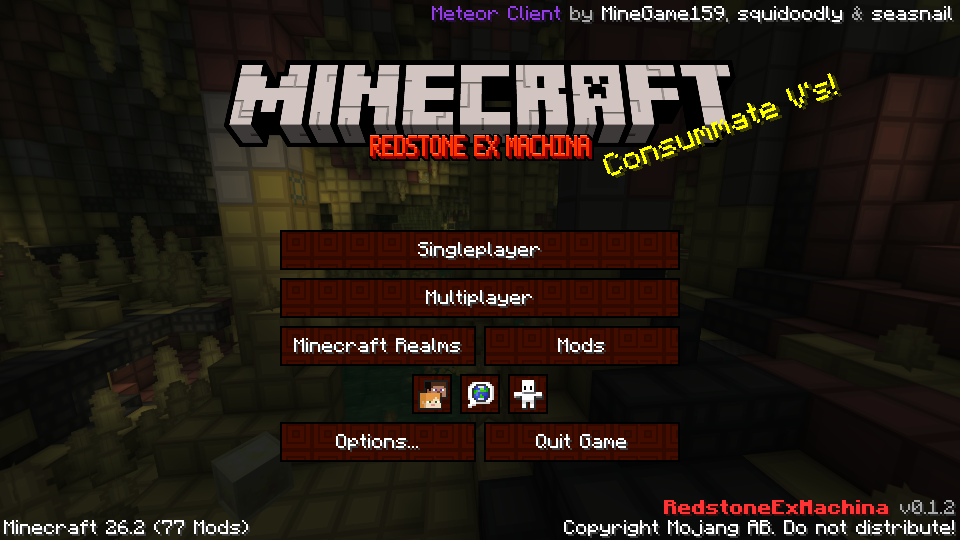
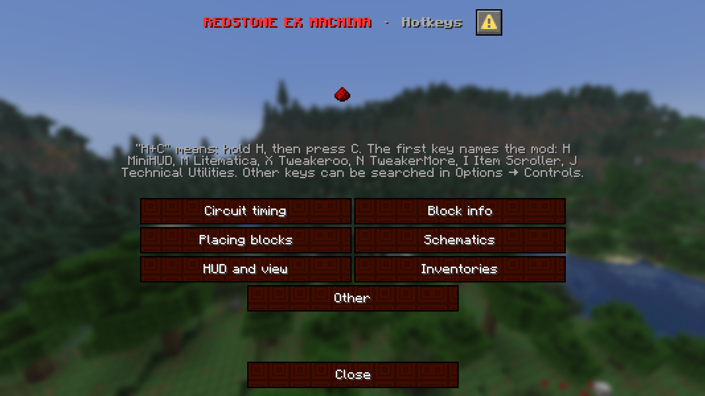
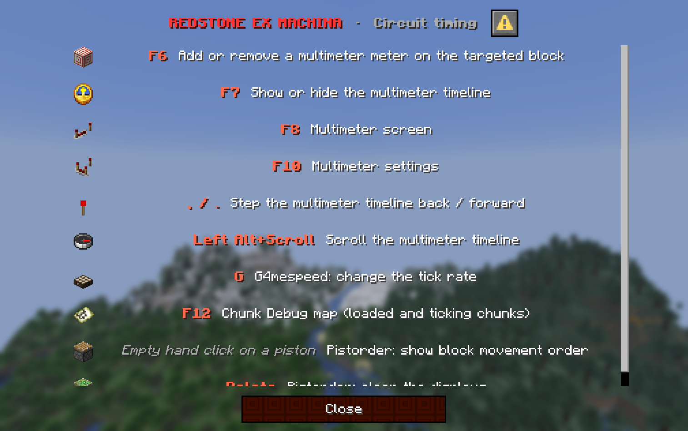

# RedstoneExMachina

A Minecraft 26.2 modpack for technical players.

[Download](https://github.com/federicotorrielli/RedstoneExMachina/releases/latest) · [Mod list](MODS.md) · [Hotkeys](https://federicotorrielli.me/RedstoneExMachina/hotkeys.html) · [Changelog](CHANGELOG.md)

RedstoneExMachina runs on Fabric. It is based on [Fabulously Optimized](https://modrinth.com/modpack/fabulously-optimized), which keeps the game fast. The pack adds the tools that redstone builders use every day. Their hotkeys are arranged so that no two of them clash.

## What you get

- **Circuits.** Redstone Multimeter records a timeline of redstone events. G4mespeed changes the tick rate. Pistorder shows the order in which pistons move blocks. Chunk Debug shows which chunks are loaded. Carpet and Carpet TIS Addition add profiling and timing logs.
- **Building.** Litematica loads schematics and can place their blocks for you. Tweakeroo adds flexible and accurate block placement. Item Scroller and Chest Tracker help with inventories and storage.
- **Information on screen.** MiniHUD shows your position, your position inside the chunk, your facing, yaw and pitch. It also shows the block you look at, with its states and its comparator output. TweakerMore writes comparator levels and hopper cooldowns directly on the blocks.
- **Look.** Photon shaders (press `K`), Redstone Tweaks and a red interface with redstone block buttons.

## Install

1. Download the `.mrpack` file from the [latest release](https://github.com/federicotorrielli/RedstoneExMachina/releases/latest).
2. Import the file. In Prism Launcher, choose *Add Instance*, then *Import*. In the Modrinth App, choose *Library*, then *+*, then *From file*.
3. Start the game with Java 25 and about 8 GB of memory.

The launcher downloads every mod from Modrinth and checks each file. The pack creates your settings only on the first start. A new version of the pack keeps the settings that you changed.

## Hotkeys

In the game, open the pause menu and click **Press here for hotkeys**. A menu opens with seven pages: circuit timing, block info, placing blocks, schematics, HUD and view, inventories, other. Every hotkey has its own item icon.

  
  

"H+C" means: keep H pressed, then press C. The first key names the mod. C opens the settings of that mod.

| Key | Mod |
| --- | --- |
| `H` | MiniHUD |
| `M` | Litematica |
| `X` | Tweakeroo |
| `N` | TweakerMore |
| `I` | Item Scroller |
| `J` | Technical Utilities |
| `A` | all of them in one list |

The [full list of hotkeys](https://federicotorrielli.me/RedstoneExMachina/hotkeys.html) is also online.

## Building the pack

The pack is kept as a Prism Launcher instance. The scripts in `tools/` convert that instance into this repository and into the `.mrpack` file.

| Script | What it does |
| --- | --- |
| `export_pack.py` | Writes the mod list, the overrides and the `.mrpack` file. |
| `install_mrpack.py` | Installs a `.mrpack` file into an empty folder and checks every download. |
| `update_mods.py` | Updates mods and packs to their newest Modrinth version. |
| `hotkeys.py` | Stores the pack version and the hotkey table. It builds the hotkey menu and the hotkey page. |
| `make_ui_pack.py` | Builds the red interface resource pack. |
| `health_check.py` | Checks files, configs, hotkeys, logs and available updates. |

## Credits and license

All mods belong to their authors. [MODS.md](MODS.md) lists them. [NOTICE.md](NOTICE.md) gives the details for the files that come with the pack. The configuration, the scripts and the interface pack are released under the [EUPL-1.2](LICENSE).

RedstoneExMachina is not an official Minecraft product. It is not approved by or associated with Mojang or Microsoft.
